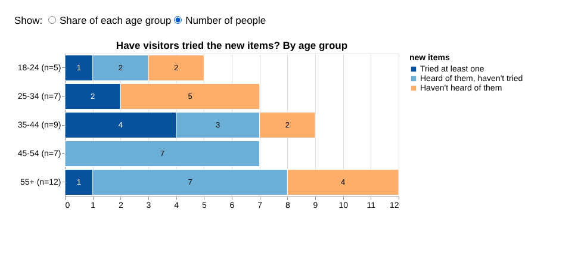
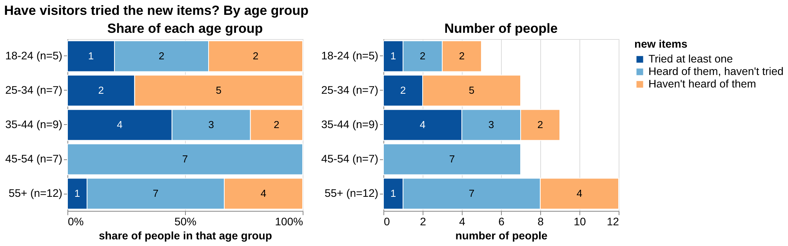

# Assignment 3
 
## Task 1: Implementing interaction

I picked the Direction 1 chart from Assignment 2, the stacked bars showing whether visitors have tried the new items, and changed what it compares. Now each bar is an age group, split into people who tried at least one new item, people who heard of them but haven't tried, and people who haven't heard of them. This supports the question of whether awareness of the new items differs by age.

The two ways of reading these bars give different answers. If you count people, the biggest group is whichever age group is largest. If you look at share of each group, small groups can stand out. For example, 55+ has the most people who heard of the items but haven't tried them (7), but 45-54 has the biggest share (all 7 of them).

**Interactive version** (`interactive.html`): one chart with a switch between "Share of each age group" (every bar runs to 100%) and "Number of people" (each bar's length is the head count). The interaction is a change of aggregation, meant to help with tasks where you need to switch between comparing groups of different sizes and comparing how many people are in each category.

**Static version** (`static.html`): the same two views side by side, one showing shares and one showing counts, so everything the switch can show is visible at once. It uses the same data, colors, labels, and order. I did not remove or hide anything from it. The tradeoff is that it takes more room, and the reader has to look at the right chart for the question.

Both versions use the same cleaned dataset (40 responses, `data/processed/survey_clean.csv`), and the three groups are defined the same way as in Assignment 2.

## Task 2: Evaluation design

**Question and hypothesis.** When people compare age groups on how they reacted to the new items, does switching between a "share" view and a "number of people" view in one chart (interactive) work better than seeing both views side by side (static)? My hypothesis is that accuracy will be about the same and that the interactive version will be faster, because it shows only the one view each question needs. Switching could also cost time, so either result is possible.

**Tasks.** There are two analytical tasks, each with two variants that use different parts of the data but need the same skill. In the first, people compare two age groups on a share, where the group with the larger head count is the wrong answer (for example, "which has the larger share who haven't heard of the new items: 18-24 or 55+?"; the answer is 18-24, 40% vs 33%). In the second, they add up head counts across three age groups, one of which has no bar because its value is zero (for example, "how many people aged 35 or older haven't heard of the new items?"; the answer is 6). Both tasks need more than reading one bar, and both are possible in either version. The full wording and expected answers for all four questions are in `study/protocol.md`.

**Design.** Within-subject: every participant uses both versions and answers four questions, two in each. Order is counterbalanced with four groups: static first or interactive first, crossed with which variant set goes with which version. Participants are assigned to groups in rotation, so each version is used first by half of them and each variant set appears equally in each version. The order of the two tasks inside a version is always the same.

**Measurements.** Accuracy (exact match with the expected answer) and completion time in seconds, plus a 1–5 confidence rating and notes on what I observe. Before starting, I fixed these rules: a 120-second limit per question; a timed-out or skipped question counts as wrong, with the time recorded as 120 (or the time they gave up); the last answer before saying "done" counts; nobody is told if an answer was right until the end.

**Procedure.** Same laptop and browser for everyone, with a fixed script: a short explanation of the chart, an unscored practice question in each version (including how the switch works), then the four questions, timed with a stopwatch. I aim for 12 participants who are not me, plus 1 or 2 pilot people who don't count. The protocol is frozen after the pilot, and changes made after it are listed in Task 3.

## Task 3: Conducting the evaluation
## Task 4: Quantitative analysis
## Task 5: Reflection and recommendations
